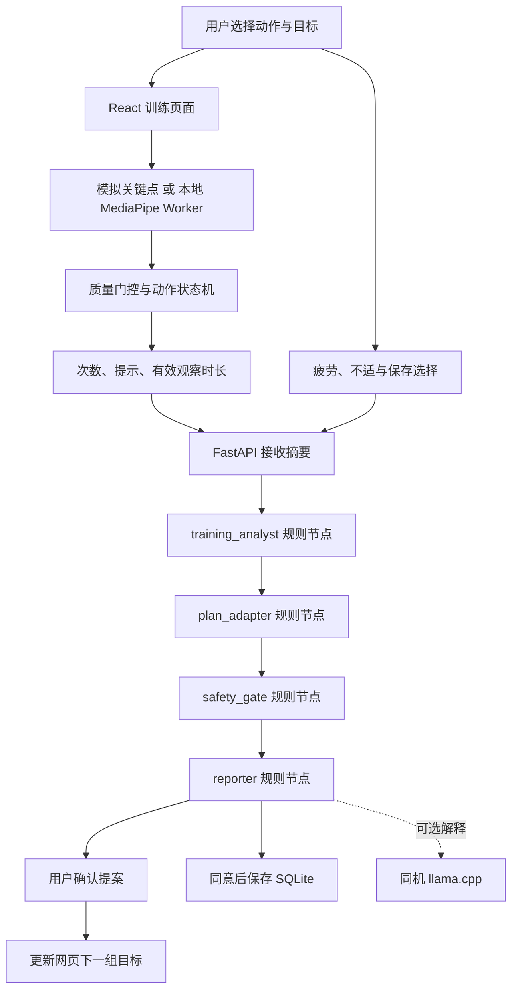

# 架构与 Agent 流

## 当前运行图



当前不是 LangGraph 实现，不包含模型角色间自主对话。采用轻量确定性基线便于验证接口、冲突规则和交互。后续把节点移入 LangGraph StateGraph，保持 API 合同。

## 模块边界

- 摄像头原始帧仅在浏览器主线程与同源 Worker 间传递，不发送后端。
- Worker 只提取姿态；动作引擎独立可测试，不依赖 React。
- 前端累计实际活动时长与最近有效姿态覆盖时长；暂停不计时；长时间追踪丢失重置动作阶段，避免跨缺口计数。
- 后端仅接收有限字段摘要，不接收视频、音频或关键点数组。
- 规则协作形成候选计划；用户确认才能更新目标；不适提案禁止确认。
- LLM 仅解释已有提案，不能写状态。异常或未启用时用规则解释降级。
- 默认同机单用户、单进程。没有认证、多人隔离或跨进程锁，不可直接暴露公网。

## 状态与合同

```text
训练状态：ready → running ↔ paused → summarized → proposal_pending → accepted
不适事件：任何 running 状态 → paused；后端提案 blocked
姿态丢失：短缺口不计数；超过 500ms 重置阶段
摘要版本：新会话 1；同 session 更新必须严格递增
确认版本：必须匹配当前 input_version，否则 409
```

阈值和 500ms 是当前实验规则，待评测优化。当前 UI每次复盘生成新 session_id；API 也支持同会话版本更新。已保存报告可从历史读取；重启后不会恢复内存中的待确认提案，避免意外执行旧计划。

| 合同 | 当前实现 |
|---|---|
| PoseFrame | Worker 的 points＋timestamp，仅浏览器内 |
| ExerciseEvent | Metrics 的 reps、phase、quality、hint、events |
| SessionSummary | 后端 Pydantic schema；前端组末提交 |
| PlanProposal | 目标次数、休息秒数、理由、blocked、status |
| AgentTrace | role、runtime、session_id、input_version、timestamp、evidence、decision |

## 目标架构增强

加入档案与校准服务、训练历史检索、经核验食品库和引用、语音事件、LangGraph 编排、性能采样与回放评测。训练与饮食可以并行处理，但计划提交单点仲裁。每节点设截止时间、输出 schema、重试上限和降级路径；低置信度不得生成强纠错。

## 性能安排

渲染与推理解耦；当前前端约每 80ms 请求一次帧，单帧在途，Worker 同步 CPU 推理。不同笔记本实际帧率未知。训练中不调用 LLM；模型解释在组末按需运行。后续考虑 GPU 后端、输入降采样和帧耗时统计，先保留可比较的 CPU 基线。

## 部署形态

开发：Vite 5173 代理 API → 127.0.0.1:8000。生产型本地运行：先构建网页，再用 Vite preview 或静态服务加 API 同源代理（本仓库 preview 暂不配置 API 代理，请仍用 dev 模式演示或自行加代理）。最终可封装桌面启动器；本次先提供两终端可复现方式。远程 GPU 模式单独标识数据边界，不算同机端侧。
