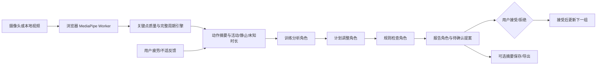

# LocalFit 技术说明与演示主线

维护：杨开元；动作与评测章节：刘小凡。2026-10-22 软件交付稿，后续需填入实际真人/设备结果。适用于组内交流和参赛技术稿的源材料。

## 问题与产品闭环

居家新手常缺少及时动作反馈，也不清楚疲劳后是否应调整下一组。LocalFit 使用本机摄像头/视频形成有限动作证据，结合用户自报疲劳和不适生成下一组提案，经用户确认才应用。原始影像不进入后端摘要接口，规则输出附版本、依据和状态记录。

主线只验证深蹲与开合跳；其余 28 项是实验目录。饮食为可确认份量的示例食物计算，原创骨架为示意外观。这些辅助模块不能代替核心可靠性证据。

## 可实现架构

四角色目前是确定性工作流，浏览器版和 FastAPI 版都可执行，同一参数与数据合同；可选本机 LLM 只解释既有结果，不覆盖计划。无需为演示改写成 LangGraph，也没有多模型协作收益证明。

模式在页面加载时固定：browser 使用本页内存/经同意的 sessionStorage；backend 使用本机 FastAPI/经同意的 SQLite。后端失败显示错误，不静默更换状态来源。资源默认严格同源；准备依赖、模型及 WASM 后用本机服务演示，整机离线能力仍须断网重启实测。

## 关键工程设计与证据

| 设计 | 对应问题 | 已取得的软件证据 |
|---|---|---|
| 完整周期与质量未知 | 中途起录、遮挡和掉帧可能虚增次数或强行纠错 | 10/20/30FPS 合成检查；缺口、起录、暂停、单帧尖峰、退化几何回归 |
| 计数与幅度独立 | 完成一次不等于幅度达标，更不等于安全 | 深蹲逐次角度/阶段时长/unknown；独立人工真值评分工具 |
| 共用合同、阈值、黄金样例 | 浏览器与后端可能生成不同计划或能耗 | 24 相同场景直接执行 TS/Python，提案与数值字段一致 |
| 版本与明确确认 | 旧会话报告或重复点击可能改错计划 | 过期/提案身份/幂等/拒绝/不适阻断/删除测试 |
| 先保存成功再提交内存 | 磁盘或浏览器存储失败可能留下半完成决定 | 故障注入后状态保留、原版本重试测试 |
| 分段能耗范围 | 次数、可见性不能代替真实运动时长 | 实际时钟、工作/静止/未知分离；未知不补造；跨端分段样例 |

自动测试 120+61 项通过，构建与本地资产检查通过。12 个合成片段和 24 个规则场景不属于真人实验；固定计划对照仅说明规则行为差异。完整结果及源哈希见 [实施与交接](IMPLEMENTATION_2026-10-22.md)。

## 五分钟演示建议

1. 约 30 秒：说明对象、两核心动作及当前运行模式，指出数据本地处理和规则边界。
2. 约 90 秒：实际完成一组深蹲；展示计数与幅度分开，遮挡后显示 unknown；真实动作不稳时承认失败，再用明确标记的模拟作流程兜底。
3. 约 60 秒：自报疲劳较高，查看减量/延休依据；先拒绝保持原计划，再用新会话接受提案，展示版本与确认。
4. 约 60 秒：展示开合跳完整周期、静止和出画，解释不会把未知补作运动时长。
5. 约 60 秒：展示实际评测文件、失败案例与运行设备；仅在真人实验已完成后展示其精度；交代后续限制。

录屏前必须填：正式候选 commit、普通笔记本型号、真实参与者/组数、真人计数与门控指标、延迟/资源占用、断网重启结果、素材/模型/MET 来源。此稿不应填入未经验证的数字，最终介绍 PDF/视频由团队在 10/28 前统一版本。
